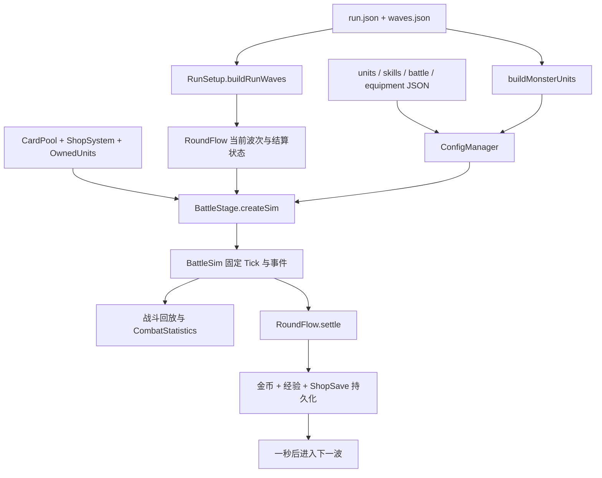

# P0：PVE 敌军动态难度与智能布阵审计

审计日期：2026-10-15（Asia/Shanghai）。项目：`D:/cocos/NewProject`，Cocos Creator 3.8.8。

**P0 已完成：现状审计、现有模拟器验证、改动前基线归档。游戏源码和配置未修改；P1～P4 尚未实施。** 当前只有固定阵容单场批量模拟器，没有整局 `run-sim`。因此不能提供正常玩家升星时间、三档机器人通关率或新预算权重的标定结论。

基线 Git HEAD：`6f9fd294c203bedb2f116bfaa169aaf32f265f2a`。开始工作时已有 `settings/v2/packages/information.json` 未提交改动，本次未修改该文件。实际输入配置及 120 个已跟踪源码/配置/工具/测试文件的 SHA-256 已归档，避免后续只按提交号比较时遗漏工作区差异。

## 1. 实际数据流



- [BattleStage.start/loadConfigs/createSim](D:/cocos/NewProject/assets/scripts/view/BattleStage.ts:77) 负责组装。敌军先加入 `placements`，玩家按持有 uid 升序加入；模拟 id 由数组顺序决定。
- [RunSetup](D:/cocos/NewProject/assets/scripts/core/RunSetup.ts:60) 在进局时一次生成整局敌军，没有玩家阵型输入，也没有预算、装备或智能等级输入。
- [BattleSim](D:/cocos/NewProject/assets/scripts/battle/BattleSim.ts:43) 复用 `ConfigManager.scaleUnit → equipmentStats → Unit`，负责战斗规则、随机数与事件。
- [RoundFlow](D:/cocos/NewProject/assets/scripts/core/RoundFlow.ts:55) 控制准备、战斗、结算、结束，并阻止重复结算；[BattleStage.settleBattleEnd](D:/cocos/NewProject/assets/scripts/view/BattleStage.ts:821) 再发金币与经验。
- [ShopSave](D:/cocos/NewProject/assets/scripts/core/ShopSave.ts:64) 保存玩家、商店预留、卡池、阶段进度及最近结算，不保存已生成敌军或运行中的 RNG 状态。

## 2. 八项现状回答

### 2.1 敌军数量、费用、星级、装备及属性如何决定

第 1 阶段固定使用 `run.json.introWaves` 的三波野怪，人数为 1、2、3，均为 1★、`statMultiplier=1`。`buildMonsterUnits` 取初始 1 费战士作基准，将生命、攻击、双抗等缩为 25%，攻速单独固定为 0.75 次/秒，保留怪物射程与移动间隔并清除主动技能。实际生命为 175；原始攻击 13.75 在实例化时四舍五入为 14。野怪不进商店和卡池。

从第 2 阶段开始，令 `k` 为已完成的非野怪波数，初始为 0：

`population = min(10, 1 + floor(k / 3))`

全局第 31 波，即 6-2，达到 10 人。阶段切换不重置这个计数，但第 1 阶段结束进入 2-1 时人数从 3 降到 1。费用与星级由 `run.json.enemyProgression.tiers` 统一决定：

| 阶段 | 全队费用 | 全队星级 | 其他属性 |
| --- | --- | --- | --- |
| 2～3 | 1 费 | 1★ | `statMultiplier=1` |
| 4～5 | 2 费 | 1★ | 同上 |
| 6～7 | 3 费 | 2★ | 同上 |
| 8～9 | 5 费 | 2★ | 同上 |
| 10～99 | 5 费 | 3★ | 每阶段增加伤害增幅、减伤 |

规则取“不超过档位费用的最高已实现费用”，然后仅在这个费用中按 `units.json` 顺序循环取人；不是混合费用抽样。当前 4 费虽有两名单位，却没有对应敌军档位，故不会进入生成敌军。5 费只有末影人，因此第 8 阶段起全是末影人。

第 `s` 阶段的晚期附加值：

`damageAmp = max(0, s - 9) × 0.05`

`damageReduction = min(0.8, max(0, s - 9) × 0.05)`

第 10 阶段开始为 5% 增伤、5% 减伤，第 25 阶段减伤达到 80%，第 99 阶段增伤为 450%。`statMultiplier=1` 并不表示双方没有额外强度差异。星级缩放主要改变生命、攻击和技能；护甲、魔抗不随星级倍率增长，攻速也不随星级统一增长。

当前 `WaveEnemy` 没有装备字段，`BattleStage.createSim` 也不向敌方传装备，所有实际敌军均为 0 件装备。

### 2.2 阶段、波次、精英与 Boss

`stageRoundCount` 的规则是第 1 阶段 3 波；第 2 阶段 5 波，之后每阶段 +1，最多 10 波。因此 3 阶段共 14 波，6 阶段共 38 波，99 阶段共 968 波。全局波 id 连续，从 1 开始。

**逻辑层没有精英/Boss 分类、倍率或专属结算。** [BattleUI.refreshRun](D:/cocos/NewProject/assets/scripts/ui/BattleUI.ts:834) 把非首阶段末尾图标画成 `wave_boss`，这是界面标识。它不改变生成、强度、技能或奖励，不能直接当作既有 Boss 规则。

当前不存在统一的阶段初缓和系数。阶段边界可能人数不变、加人、换费用或整队升星，不能保证末波挑战及次阶段回落。

### 2.3 战力计算、装备价值和模拟器

没有单位战力估值、费用权重、装备价值表、预算误差、自动调参、三档机器人或整局模拟入口。

现有 [tools/batch-sim.ts](D:/cocos/NewProject/tools/batch-sim.ts:1) 只给一套固定的战士/弓手/法师 3v3 阵容更换战斗种子，输出胜负、平均时长和事件数；不读取 `run.json/waves.json`，不跑商店、玩家成长、连续掉血或装备奖励。`package.json` 的命令是 `batch`，没有 `run-sim`。

可直接复用的能力包括：纯 TS `BattleSim`、带种子 `Rng`、完整事件队列、`CombatStatistics` 实际伤害/治疗统计、星级与装备计算，以及纯 TS 商店、经济、持有单位、等级和回合状态机。当前可购买单位 15 名，1～5 费数量分别为 **4/5/3/2/1**。

### 2.4 六边形坐标与距离

实际是**尖顶 odd-r offset**：奇数行水平右移半格，布局为 7 列 × 8 行。玩家半场 `y=0..3`，敌方半场 `y=4..7`，各 28 格。敌方前排朝向玩家，深度从 `y=4` 向 `y=7` 增加。

[HexMath](D:/cocos/NewProject/assets/scripts/battle/HexMath.ts:1) 先用 `q=x-(y-(y&1))/2, r=y` 转 axial，再求 cube 距离；[Pathfinding](D:/cocos/NewProject/assets/scripts/battle/Pathfinding.ts:1) 使用同一套六邻接 BFS。例：`(3,3)` 与 `(4,4)` 的 hex 距离是 1，曼哈顿距离是 2。智能布阵必须复用 `hexDist/hexNeighbors`。

`Grid.ts` 顶部仍写着“平顶 odd-q、8×6”，属于过时注释；当前调用传入实际 7×8，不能按该注释重做坐标。`BoardGeometry` 是显示投影，不改变战斗坐标。

现有敌军实际仅占 `enemyProgression.cells` 的前 10 个格：`y=4/5` 的 `x=3,2,4,1,5`，与角色无关。当前 99 阶段全部生成格已检查：合法、无重叠、最多 10 人。

### 2.5 玩家何时达到 2★/3★

**目前无法给出真实平均时间或分布。** 项目没有玩家行为数据、整局机器人或相关指标采集。

已确认的成长规则：

- [OwnedUnits.tryMerge](D:/cocos/NewProject/assets/scripts/core/OwnedUnits.ts:152) 三张同名同星自动合成，2★需 3 张基础卡、3★需 9 张；棋盘与备战席共同参与合成。
- 开局 0 金、1 级，领取一名 1★战士到备战席。商店 5 格，每回合免费换店，锁店时保留；手动刷新 2 金。
- 购卡价格按费用为 `1/2/3/5/8` 金。每种棋子卡池库存为 `30/25/18/10/9`。商品抽出即预留，不可绕过商店直接无限买卡。
- 每波结束 +2 经验；4 金换 4 经验。上阵上限等于等级，最高 10 人；默认备战席 9 格。
- 基础收入 `min(阶段×2,10)`，另加胜利 1 金、余额 10% 利息（最多 5 金）、连胜/败奖励（最多 3 金）。当前基础收入已有 10 金封顶。
- 当前准备和战斗时都允许买卡、刷新、买经验；战斗中的上阵快照与持有列表分离。机器人必须明确操作时点，遵守相同规则。

已有 `progression-tests.cjs` 的“整局全胜”使用 15 名全 3★单位，超过玩家最多 10 人，且其中一名放在 `y=4`；它是战斗/流程压力用例，不能当作正常玩家或强策略通关证明。九张卡能合成 3★的测试也不代表玩家在某阶段买得到九张卡。

### 2.6 手写阵型能否复用

`waves.json` 有 7 套手写阵型，包含前后排、混合星级和属性倍率。现有坐标在敌方半场且没有重叠，单位 id 可解析，具备作为特色阵型模板的基础。

但 `buildRunWaves` **只取模板名称，不取 `enemies`**。本次把所有模板 `enemies` 临时置空后生成前 3 阶段，输出完全不变，证明这些阵型未生效。第 8 阶段之后复用第 7 套名称“终焉守门者”，并不代表应用其阵型。

不能原样作为新 Boss 阵容：第 7 套含两名 3★，且多套使用 0.7/0.85/1.15/1.25 等倍率，与新规则“Boss 最多一名 3★、属性微调 0.95～1.05”冲突。应优先保留站位意图，重新做人数、角色、预算、星级和格子合法性检查。

### 2.7 装备、掉落、存档与其他机制

- 已有 3 槽装备管线、背包、穿戴/卸下、合并溢出与出售返还。当前只有鬼索、不死图腾、珠光护手、无尽之刃四件装备，均含特殊效果；没有现成的三件早期基础装备候选池。
- 装备由 `ConfigManager.equipmentStats`、`Unit.attackSpeed`、`BattleSim` 共同执行；攻速按绝对值相加，上限 5 次/秒，鬼索每场重新叠层。不能另写一套装备战力效果来替代实战计算。
- 玩家当前可从界面授予装备入口获得装备；未发现自然战斗掉落、精英/Boss 三选一、阶段保底、待领取奖励或防重复领取 id。
- `RoundFlow.settle` 中获胜不掉血，其他结果按 `min(当前生命, 敌方存活数×2)` 扣血；超时平局同样可能扣血。最后一波只要仍有生命就判整局胜利，不要求最后一战获胜。后续必须区分“战斗胜率”“存活完成整局”“Boss 被击败”。
- [BattleStage.scheduleNextWave](D:/cocos/NewProject/assets/scripts/view/BattleStage.ts:815) 默认结算后一秒自动下一波。新增待领取奖励时必须拦住此路径及手动下一波，领奖后再推进，避免跳过奖励。
- 存档 schema 为 v2，另有 `runRulesVersion=2` 用于旧波次索引迁移。没有 `runSeed`、随机流状态、敌军生成版本、战力标定版本或待选装备字段。战斗中读档回到准备阶段。
- 当前没有实际羁绊、召唤或遗物管线。祭司目前使用伤害技能，不是治疗辅助；小樱治疗自身，不是团队治疗。末影人已有传送强化，普通近战没有统一冲锋机制；不能为 L3 凭空赋能。

### 2.8 与方案直接冲突的规则

1. 现有整队费用/星级切换、普通波多名 3★、晚期额外增伤减伤，均需由预算规则替换；不能只叠加预算算法后保留原增益。
2. `1/1.8/3.24` 与基础生命/攻击及通用技能缩放吻合，但不是所有单位的实际战力倍率。5 费 3★另加 **5000 生命**：末影人 1★/2★/3★生命分别为 `1000/1800/8240`。其 3★技能为 50 倍强化攻击、永久强化并提高攻速；鼬的 3★眩晕 5 秒等也不满足线性估值。标定必须记录这些特殊曲线。
3. 保持每波 `×1.04` 指数增长直到全局第 968 波，同时最多 10 人、普通波最多 2★、装备最多 3 件、属性微调上限 1.05，存在最终不可达的预算。需要明确预算曲线适用范围/饱和策略或报告 infeasible，不能暗加属性凑 ±5%。
4. “普通/精英/Boss 1/1.15/1.35”是新增机制；不能声称现有项目已有这些判定。建议配置阶段末为 Boss、较长阶段的倒数第二波为精英，但须作为显式新配置实施。
5. Boss 后若直接用普通波倍率，下一波预算比值为 `1.04/1.35≈0.7704`，约回落 23%，并非 5%～8%。需要联合求解 pacing 与分类倍率，避免重复叠加。
6. 若早期只允许基础装备且三选一必须三个不同候选，现有四件装备内容不足。应增加最小基础装备配置或明确候选不足的降级方式，不能复制候选冒充三件。
7. 原有“阶段增长后不回落”的历史设计与本次“阶段首短暂恢复”不同；后续按本次方案调整，并同步更新旧测试的数值预期，保留扩大阶段数不改变既有前缀的要求。

## 3. 已保存的模拟基线

所有结果在 [baseline 目录](D:/cocos/NewProject/docs/p0-enemy-difficulty/baseline/manifest.json)；配置快照是改动前配置，不包含为拟议新系统编造的权重。

### 3.1 原有入口与可复现性

实际执行两次：

```powershell
Set-Location D:\cocos\NewProject
npm.cmd run batch -- 1000 1
```

| 指标 | 第一次 | 第二次 |
| --- | --- | --- |
| 种子 | 1～1000 | 1～1000 |
| 己方胜 | 153（15.3%） | 153（15.3%） |
| 敌方胜 | 826（82.6%） | 826（82.6%） |
| 平局 | 21（2.1%） | 21（2.1%） |
| 平均战斗时长 | 18.2 秒 | 18.2 秒 |
| 平均事件数 | 141 | 141 |

同样的实际布阵用审计工具再次运行，精确均值为 18.15505 秒、141.382 事件；1000 场完整结果及事件序列聚合 SHA-256 均为 `9ce67c10478b080cecb80cdb2a8fddf1050c602f0743fd097556e0415f26fadf`。己方胜率 Wilson 95% 区间约 13.20%～17.66%。运行耗时受机器状态影响，不作为确定性指标。

这套 3v3 的位置不对称，因此 15.3% 不是阵营公平性结论，更不是默认三阶段通关率。

### 3.2 镜像与阶段诊断

新增工具仅调用现有逻辑，做以下基线检查：

- 15 名实际棋子，1★、无装备、相邻同款 1v1，每名 100 种子，交换双方实例顺序，共 3000 场。逐项胜负见 `diagnostics.json.mirrors`。
- 战士示例：己方先分配 id 时 27 胜/38 负/35 平；交换 id 顺序后为 38 胜/27 负/35 平。单边有限种子样本会受 RNG 消耗顺序影响，后续标定必须配对换边、换位置和扩充种子；不能用单次结果定价。
- 关闭暴击的同款战士在两个实例顺序下都同 Tick 双杀，未出现先处理的一方剥夺另一方致命攻击的现象。
- 固定五名 2★：战士 `(3,3)`、卫士 `(2,3)`、游侠 `(4,1)`、法师 `(2,0)`、小樱 `(4,3)`。每波重新开始，敌方先生成，前 10 阶段共 78 波，每波种子 1～100，共 7800 场，使用真实 `RoundFlow` 算本场掉血、真实 `CombatStatistics` 算伤害。

| 波次 | 固定阵容单场胜率 | 平均本场掉血 | 平均战斗秒数 |
| --- | --- | --- | --- |
| 3-6 | 100% | 0 | 8.24 |
| 4-1 | 100% | 0 | 8.79 |
| 5-1～5-3 | 100% | 0 | 18.04 |
| 5-4～5-6 | 45% | 2.70 | 20.40 |
| 5-7～5-8 | 0% | 9.38 | 17.26 |
| 6-1 | 0% | 16.00 | 9.09 |
| 7-1 | 0% | 18.00 | 8.77 |
| 8-1 | 0% | 20.00 | 6.23 |
| 10-1 | 0% | 20.00 | 3.81 |

**这些是固定阵容逐场对照，不包含购买、利息、升级、换装、连续生命或淘汰。** 不能据此推断中等策略通关率，也不能把五名 2★当作阶段 5 玩家的合理成长事实。每场的新生命为 20，所以平均掉血最多 20。逐波胜率区间、余血、输出和事件哈希见 `diagnostics.json` / `encounters-before.csv`。

原始敌军属性也支持断崖判断，但只作为属性证据：

| 边界 | 敌军人数 | 队伍生命总和 | 变化来源 |
| --- | --- | --- | --- |
| 5-8 → 6-1 | 9 → 9 | 6400 → 12150（+89.8%） | 2 费 1★整队变 3 费 2★ |
| 7-10 → 8-1 | 10 → 10 | 12870 → 18000（+39.9%） | 3 费混合身份变成全末影人 |
| 9-10 → 10-1 | 10 → 10 | 18000 → 82400（+357.8%） | 全队 3★及每名额外 5000 生命，另附增伤/减伤 |

生命总和不是综合战力；这张表没有计入技能、减伤、射程和控制的非线性收益。

### 3.3 复现命令与基线文件

```powershell
Set-Location D:\cocos\NewProject
npm.cmd test
npm.cmd run batch -- 1000 1
# 选择尚不存在结果文件的新目录；工具拒绝覆盖既有基线
node tools/audit-enemy-p0.cjs temp/p0-enemy-audit-new
```

- `manifest.json`：HEAD、运行时版本、源码哈希、工具哈希、命令与输出清单。
- `input-configs.json`：units/skills/battle/run/waves/equipment 六类输入快照。
- `waves-before.json` / `waves-before.csv`：全部 99 阶段、968 波的实际生成阵容及属性摘要。
- `diagnostics.json` / `encounters-before.csv`：固定 3v3、镜像、阶段诊断、配置缺陷探针、置信区间与事件哈希。
- `npm-test.log`、两份 `batch-1000-seed1*.log`、`audit.log`、`recheck.log`、`verification.log`：实际执行证据。
- `overwrite-guard.log`：故意指定已有结果目录时的预期拒绝，属于覆盖保护检查，不是游戏测试失败。

P0 不创建名为 `run-sim` 的占位命令，避免让固定阵容探针被误当成完整爬塔机器人。

## 4. 问题、证据、复现方法和风险

这里的“高/中/低”描述对新系统正确性、玩家体验和标定可信度的影响，不表示已在 P0 修复。

| 编号/风险 | 问题与证据 | 复现 | 后续处理 |
| --- | --- | --- | --- |
| R1 高 | 阶段 6/8/10 整队切档，阶段 10 十名 3★；见上述边界属性与固定阵容结果 | 查看 `waves-before.csv` 的 29/30、48/49、68/69 波 | P1 混费混星预算，去掉原晚期免费增益 |
| R2 高 | 没有整局 `run-sim`/机器人；原 batch 不读关卡 | `npm.cmd run`、阅读 `tools/batch-sim.ts` | P1 前先补共享整局运行入口；P4 才能验收累计通关率 |
| R3 高 | 3.24 不是 5 费 3★真实生命或技能价值；`scaleUnit` 加 5000 HP，技能有 50 倍强化 | `diagnostics.json.starExamples`、`skills.json.ender_ambush` | 分星级/单位/装备组合标定，保留共用战斗计算 |
| R4 高 | `BattleStage` 用 `Date.now()` 初始化商店 RNG，预览重建也从同一流抽战斗 seed；存档不记录 RNG | 查看 `BattleStage.ts:103/253/330`，买卡/拖动会重建预览 | 独立派生随机流，持久化种子与需要的流状态，禁止敌军消耗商店流 |
| R5 高 | 生成器只检查格非负，未校验棋盘上界或敌方半场 | 工具把首格改为 `(7,4)`：生成接受，实例化报越界；改为 `(3,0)`：生成和实例化均接受 | P1/P2 在共享生成入口校验合法敌方部署区，非法模板明确回退 |
| R6 高 | 新奖励若直接接现结算，会被一秒自动推进跳过；缺 pending/领取 id | `BattleStage.scheduleNextWave/restart` 和 `ShopSave` 无奖励字段 | P3 持久化待选奖励、幂等领取、领奖前阻止推进及读档恢复 |
| R7 中 | 有 Boss 图标却无战斗分类，手写阵型不生效 | 清空模板 enemies，生成结果不变；`WaveConfig` 无 kind | 显式新增波次分类配置；P2 选用已校验特色阵型 |
| R8 中 | “整局全胜”测试使用 15 名 3★且越过玩家半场，不符合玩家规则 | 查看 `tests/progression-tests.cjs` 的整局循环 | 保留其流程用途，另加合法人口/经济约束的 campaign 用例 |
| R9 中 | 装备内容全是特殊装，早期基础三选一池不足 | 当前 `equipment.json` 仅四件 | P3 增加必要配置或定义候选不足策略；不临时免费塞装备 |
| R10 中 | 99 阶段指数预算与有限人数/槽位/星级存在不可达区间 | 968 波曲线与 10 人/3 槽上限共同分析 | P1 限定曲线适用区间或饱和/不可达报告；有限优化必终止 |
| R11 中 | 双方 ID 顺序影响 RNG 分配，固定 3v3 位置也不对称 | 镜像 1v1 换 ID，战士 27/38 ↔ 38/27 | 标定配对换边、位置、种子，保存置信区间与样本数 |
| R12 低 | `Grid` 注释与实际 hex 约定不符 | 对照 `Grid.ts:1` 与 `HexMath.ts:1` | P2 同步注释，不改变已经验证的坐标算法 |

现有配置没有生成非法格；R5 是修改配置后的验证缺口，不能描述成当前所有对局站位错误。当前所有 968 波合法性检查已通过。

## 5. 具体实施方案：按模块推进

### P1：先补可标定入口，再做预算生成

建议分成三个独立、可回退的小改动：

1. **共享纯 TS 整局入口与确定性上下文。** 新建 `core/RunSession.ts`，复用 ShopSystem/CardPool/OwnedUnits/EconomySystem/LevelSystem/RoundFlow；把与场景无关的准备、开战快照、结算、推进接口供 UI 和工具共用。`BattleStage` 保留节点/交互。新建 `tools/run-sim.ts` 和 runner，明确动作在准备/战斗哪个时点执行，不复制金币或升星规则。加入 `runSeed`、规则/标定版本以及必要 RNG 状态迁移；新旧存档都测。
2. **离线校准。** 新建 `tools/calibrate-enemy-power.ts`，记录多棋子、费用、星级、装备、换边与位置的矩阵，再做控制/治疗/AoE阵容验证。复用真实 BattleSim 与 CombatStatistics。镜像只是正确性基线；费用 5 仅一名样本、特装和 3★异常单独标记可信度。输出 `enemy-power.json`，含版本、配置哈希、样本量、种子、区间与拟合误差；未完成时不填“已标定”权重。
3. **预算与阵容。** 新建 `core/EnemyBudget.ts`、`core/EnemyGenerator.ts` 及 `enemy-difficulty.json`，由 `RunSetup.buildRunWaves` 兼容包装接入，保留现有 stage/round/id 语义与人数曲线。只在显式新配置启用后替代旧 tiers/晚期增幅。组合搜索有候选上限、局部迭代上限、人口与前排约束；输出目标/实际预算、误差、微调值与不可达原因。普通/精英无 3★，Boss 最多一名；预算不足不可暗改属性。

建议新增接口（仅设计，P0 未加到游戏）：`EnemyGenerationContext { runSeed, waveId, stage, round, waveKind, rulesVersion, calibrationVersion }`；`EnemyGenerationResult { enemies, targetBudget, actualBudget, deviation, adjustment, diagnostics }`。`EnemyPowerModel` 接受既有单位 id、star、equipment，不另算战斗属性。

需要测试：相同上下文输出完全一致；不消耗商店 RNG；扩大到 6/99 阶段前缀不变；合法区/空配置/最低预算/单一费用池/满人口/不可达预算有明确结果；禁止免费升星；误差满足时在 ±5%，不满足时报告原因；所有循环有限终止。校准版本和输入哈希不匹配时应显式拒用或回退，不能静默复用旧值。

### P2：独立布阵模块与特色模板

新建 `core/EnemyFormation.ts` 和 `enemy-roles.json`。保留用于现有展示的 `UnitConfigData.role`，用独立六类战术角色映射补足，而不是强制替换 `frontline/ranged/caster/magicArcher`。由实际技能确认 tank/support/assassin，避免按名称或射程误判。

复用 HexMath、棋盘尺寸与合法半场；L0 完整兼容 cells 顺序，L1 角色深度与掩护，L2 距离约束且空间不足降级，L3 只利用既有传送/范围/控制技能。智能解锁按配置逐步增加参与单位/权重，避免阶段全队瞬间换策略。

目前整局预生成没有玩家输入，因此 P2 要在准备阶段持有玩家阵型快照，再将本波敌军布阵结果交给预览和实际开战共同消费；读档保留快照/结果或以版本化确定性输入重建。玩家换位后何时重新布阵需形成明确一致规则，避免预览与开战用不同快照。装备及阵容生成流、布阵流、战斗流、商店流互相独立。

需要测试：odd-r 奇偶行邻接、同格排除、28 格容量/10 人、关键单位 hex 距离≥2的可行与退化场景、重复种子、ID顺序稳定、非法模板回退、旧模板多 3★不绕过预算，以及 Cocos 预览/开战位置一致。

### P3：沿用已有装备与持有数据，补奖励状态

在 `WaveEnemy` 兼容新增可选 `equipment`，通过 `BattleStage.createSim` 传入现有 Placement；敌方选装先计预算再生成，沿用 3 槽与全部被动规则。新增 `core/EquipmentReward.ts`，配置候选池、阶段解锁、普通/精英/Boss触发和保底；每项奖励有稳定 id 与三候选快照。

扩展 ShopSave 的 pending/claimed/阶段保底字段并迁移旧档；原金币与经验仍由现有结算执行一次。领奖后入背包，再允许进入下一波。UI 只新增必要三选一面板；机器人通过同一领取/穿戴动作操作，不直接改库存。

需要测试：重复 settle、重复点击领取、保存/读档待领奖、自动/手动推进阻挡、重开与中断、金币/经验不重复、候选不足处理、无重复候选（足够池时）、卖出/合并/卸装返还、敌方装备在战斗和预算两边都生效。再做实际 UI 交互验证，单靠 Node mock 不算完成。

### P4：三档合法策略与平衡验收

新建 `tools/bots/weak.ts`、`medium.ts`、`strong.ts`，使用同一 RunSession 动作接口；无免费经济、无隐藏属性、无未来商店/随机结果访问。输出每波、每阶段条件和累计指标，统计第一次获得/主力上阵 2★与3★时间，单独计未达到的删失样本，不只平均成功样本。

先保存旧规则的合法机器人基线，再切新配置做配对种子比较。以 500～1000 个种子作为正式起步样本，报告 Wilson/适当重采样区间；只有区间和稳定性足够时才讨论 3 阶段约85%、6阶段约50%。条件阶段存活率、累计完成率、单波胜率、Boss击败率分开；阶段 5 前后输出经济、等级、主力星级，支撑敌军升星略慢的结论。

调参设最大迭代数、各参数上下界与终止误差；配置、种子集、报告、失败用例一起留存。阶段节奏与“累计率下降不超10个百分点”不混为一个硬约束，不硬编码胜负。

### 拟修改文件与风险边界

| 文件/模块 | 原因 | 主要风险 |
| --- | --- | --- |
| `RunSetup.ts`、`RoundFlow.ts`、`run.json`、`waves.json` | 接预算/分类/阵型；保留波次语义，奖励等待阻挡推进 | 旧规则前缀/存档索引；后期强度重复叠加 |
| 新 EnemyBudget/EnemyGenerator 与两个敌军配置 JSON | 预算、标定值、有限生成与诊断 | 离散不可达、有限候选池、内容与数值版本失配 |
| 新 RunSession、`BattleStage.ts`、`ShopSave.ts`、必要 `Rng.ts` 接口 | UI/模拟共用规则、独立随机流、旧档迁移 | 回放绑定、商店序列、读档确定性 |
| 新 EnemyFormation/角色表、`HexMath.ts`/`Grid.ts` 注释 | 智能布阵、模板合法性、真实 hex 距离 | 预览与开战不一致、约束无法满足 |
| 新 EquipmentReward、`equipment.json`、`BattleUI.ts` 必要奖励面板 | 三选一、保底、基础装备池 | 领奖重复、自动推进、早期候选不足 |
| `tools/run-sim.ts`、校准工具、bots、package scripts、对应 tests | 真正整局指标与校准证据 | 非法机器人、测量指标混淆、抽样偏差 |

`BattleSim`、ConfigManager、Unit、ShopSystem、OwnedUnits、CardPool、EconomySystem 和 LevelSystem 原则上复用；只为确实缺少的公共边界做最小调整，不复制一套战斗或奖励算法。P0 不提前落实这些文件改动。

## 6. P0 实际改动与验证结果

本次新增：

1. 本报告 `docs/p0-enemy-difficulty/README.md`。
2. `tools/audit-enemy-p0.cjs`：只读审计与固定夹具模拟工具，直接调用当前游戏核心；不改游戏配置、不冒充三档机器人。输出只允许项目目录内，拒绝覆盖已有基线文件。
3. `docs/p0-enemy-difficulty/baseline/*`：前述实际输入、全波次快照、模拟结果、哈希与执行日志。

本次验证：

- `npm.cmd test` **退出码 0**；包含 Cocos 已生成声明下的项目 TypeScript 检查，纯逻辑测试、冒烟、商店/阶段、交互 mock、技能、装备等。明确计数的套件为单元127、经济56、商店41、联动回归65、战斗属性9，均零失败；其他套件输出 PASS，未把它们臆算成总数。
- 原有 `batch` 两次 **退出码 0**，1000 场汇总一致。
- P0 审计工具完整执行两次，每次 **12802 场**（batch内部重复2000、镜像3000、无暴击镜像2、逐波7800），退出码均为 0；五个确定性输出文件逐字节 SHA-256 全部一致。
- 全部 968 波的格子/重复占格/人口检查、3/6/99 阶段前缀一致、源配置不变、120 个输入源码/配置/工具/测试文件哈希未变。
- 新工具语法检查通过；已有基线覆盖保护按预期拒绝。`git diff --check` 通过。

复查临时输出在忽略的 `temp/p0-enemy-difficulty-recheck`，仅用于比对；正式基线位于 docs。未运行 Cocos 编辑器场景验证、浏览器画面或真机验收；P0 没有声称任何新 UI/智能布阵已生效。

**仍待解决：** R1～R12 按后续阶段处理；真实玩家升星时间、合法机器人累计通关率、B0/费用权重/装备价值标定、预算曲线适用范围及基础装备池，均尚无完成证据。现有模拟器可运行、可重复；新系统平衡验收尚未开始。
