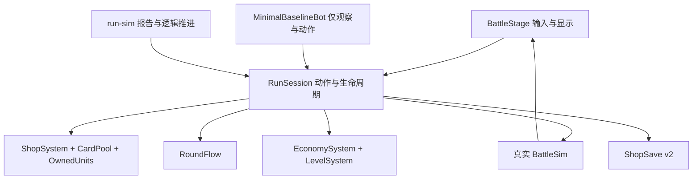

# P1-A：可复现的 RunSession 与整局 run-sim

日期：2026-10-15。范围仅为 P1-A。**已完成共享纯 TS 流程、合法最小机器人、整局命令行、存档迁移和确定性验收；未实现新敌军难度。**

先复核了 P0 报告及其 manifest、输入配置、模拟诊断和校验记录，再核对 BattleStage、RoundFlow、ShopSave、Rng、ShopSystem、CardPool、OwnedUnits、EconomySystem、LevelSystem 的当前源码。基础提交为 `6f9fd294c203bedb2f116bfaa169aaf32f265f2a`；本阶段源码的具体 SHA-256 见 [verification.json](D:/cocos/NewProject/docs/p1-enemy-difficulty/run-session/verification.json)。

## 1. 修改文件

| 文件 | 改动与用途 |
| --- | --- |
| [RunSessionTypes.ts](D:/cocos/NewProject/assets/scripts/core/RunSessionTypes.ts) | 定义会话选项、状态、合法动作、机器人观察接口、终止原因、逐波及整局报告类型。沿用 RoundFlow 的 phase/result 类型。 |
| [RunRandomContext.ts](D:/cocos/NewProject/assets/scripts/core/RunRandomContext.ts) | 独立子系统的稳定 seed 派生，规则版本和默认种子；不改既有 mulberry32。 |
| [RunSession.ts](D:/cocos/NewProject/assets/scripts/core/RunSession.ts) | 组织真实开局、读档、商店、操作、BattleSim、RoundFlow、结算及推进；无 Cocos 或计时依赖。 |
| 上述三个 `.ts.meta` | 按项目现有 TypeScript 资源格式新增独立 UUID，供 Cocos 导入。 |
| [ShopSystem.ts](D:/cocos/NewProject/assets/scripts/core/ShopSystem.ts) | 只新增 `setRollRng`，允许每次整店刷新使用派生流；抽卡、价格、库存预留和合成规则不变。 |
| [OwnedUnits.ts](D:/cocos/NewProject/assets/scripts/core/OwnedUnits.ts) | 允许恢复并读取后续 UID 分配位置；其余合成、装备、移动等规则继续复用。 |
| [ShopSave.ts](D:/cocos/NewProject/assets/scripts/core/ShopSave.ts) | v2 中兼容增加 runSeed、rulesVersion、seed 来源、商店刷新序号、nextOwnedUid；保留合法唯一 UID，修复缺失/重复 ID。 |
| [core/index.ts](D:/cocos/NewProject/assets/scripts/core/index.ts) | 导出会话、类型和随机上下文。 |
| [BattleStage.ts](D:/cocos/NewProject/assets/scripts/view/BattleStage.ts) | 初始化/购买/刷新/锁店/经验/移动/出售/穿卸装/开战/结算/推进调用同一会话；保留节点、输入、回放、倒计时和既有调试入口。 |
| [minimal-baseline.ts](D:/cocos/NewProject/tools/bots/minimal-baseline.ts) | 只实现 MinimalBaselineBot：固定购卡顺序、按星级/费用/UID排序、固定合法站位。 |
| [run-simulation.ts](D:/cocos/NewProject/tools/run-simulation.ts) | 加载真实六类配置、运行完整会话、记录逐波实际状态，支持采样上限和四种终止原因。 |
| [run-sim.ts](D:/cocos/NewProject/tools/run-sim.ts) | 参数解析、控制台摘要、JSON 写出与错误退出；禁止输出覆盖 P0 证据。 |
| [package.json](D:/cocos/NewProject/package.json) | 新增 `run-sim`，使用已有 tsx/cjs；无新增依赖。 |
| [run-session-tests.cjs](D:/cocos/NewProject/tests/run-session-tests.cjs) | 会话、规则守卫、RNG 隔离、存档、前缀、终止、合法机器人及 P0 阵容不变检查。 |
| [run-sim-cli-tests.cjs](D:/cocos/NewProject/tests/run-sim-cli-tests.cjs) | 独立进程 JSON 一致、CLI 错误退出、完成/截断区分、P0 文件保护。 |
| [regression-tests.cjs](D:/cocos/NewProject/tests/regression-tests.cjs) | 原有 65 项保留，新增 UI 多次预览不扰动和 UI/纯会话同动作同结算两项。 |
| [run-tests.ps1](D:/cocos/NewProject/tools/run-tests.ps1) | 将新工具纳入纯 TS 编译，将新增测试纳入 `npm test` 并传播失败退出码。 |
| 本目录 | 计划/架构/实际报告、日志、保护哈希及复现证据。 |

未改 `RunSetup.ts`、`RoundFlow.ts`、`BattleSim.ts`、`ConfigManager.ts`、战斗数值、商店概率、经济公式或六份游戏配置。保留开始时已有的 `settings/v2/packages/information.json` 改动；P0 报告、基线及 P0 审计工具不变。受保护的 23 个文件已逐一比对原哈希。

## 2. RunSession 架构



`RunSession` 调用已有系统，没有另写金币、卡池、抽卡、伤害、升星、经验、装备或玩家掉血算法：

1. 载入配置并使用原 `buildMonsterUnits/buildRunWaves`。
2. 修复并恢复旧档，先发正常初始棋子，再生成真实五格商店、预留库存。
3. 动作入口检查阶段、棋盘/备战席位置、人口及装备来源，再调用原系统。
4. 敌军先放入 Placement，玩家按 UID 升序；通过真实 BattleSim 构建战斗及装备属性。
5. 完成战斗后先调用 RoundFlow.settle，再发原金币与经验；重复结算不再发奖励。
6. `nextWave` 推进原 RoundFlow，再调用真实商店免费刷新；锁店仍保留。

界面保留一秒开战倒计时和一秒自动下一波。命令行直接推进逻辑，不等待动画、真实时间或计时器。Cocos 与纯会话四波对照测试使用同一配置/存档及同一机器人动作，战斗完整事件和存档完全一致。

机器人只取得 `observe()/act()`，没有可修改的经济/OwnedUnits 对象、调试发放入口、敌军列表、未来商店或随机流。观察内容为独立快照。它按五个商店格固定顺序购买买得起的棋子，每次购买后重新排序上阵；不主动刷新、不买经验、不卖卡、不选装，不读取未来敌军，不发免费资源。它只是测量基础设施的夹具，不能当作任何正式策略档位。

## 3. RNG 架构与存档

`deriveSeed(runSeed, subsystem, waveId, index=0)` 使用带 `run-rng-v1` 标签的 FNV-1a 和整数混合，结果为非零 uint32；再用项目原 `Rng` 创建局部 mulberry32 流。

| 子系统 | 输入 | 当前用途 |
| --- | --- | --- |
| shop | runSeed + `shop` + waveId + 本波整店刷新序号 | 自动刷新序号 0；成功手动刷新后递增，读档恢复 |
| battle | runSeed + `battle` + waveId + 0 | 预览与实战相同 seed，真实 BattleSim 自己消费局部 RNG |
| enemy | runSeed + `enemy` + waveId + index | 预留隔离域；本阶段原生成器仍不消耗随机数 |
| formation | runSeed + `formation` + waveId + index | 预留隔离域；本阶段不实现智能布阵 |
| reward | runSeed + `reward` + waveId + index | 预留隔离域；本阶段无装备奖励 |
| bot | runSeed + `bot` + waveId + index | 隔离测试覆盖；最小机器人本身无随机动作 |

同一 stream 请求从该派生 seed 起步，调用方在一次过程内持有该局部流。不从某个父流按调用顺序抽出其他子系统 seed；因此改变敌军、机器人或预览调用次数不能改变商店或战斗 seed。全局 waveId 来自现有连续波次，增加整局阶段数不改变相同波次的 seed。

新增的 `rulesVersion=1` 描述会话/RNG 协议，和既有 `runRulesVersion=2`（旧阶段索引迁移）分开。未知未来 rulesVersion 明确拒绝启动，不假装兼容。

存档保持 v2 的 key/版本与原字段，新增：

- `runSeed`：uint32，包含合法种子 0。
- `runSeedSource`：`explicit` 或 `legacy-default`。
- `rulesVersion`：当前 1。
- `shopRollIndex`：当前波成功手动刷新次数；失败刷新不递增，锁店跨波照常保留商品。
- `nextOwnedUid`：避免买卡、合成或出售后读档使未来单位 ID 改变。

不保存战斗 RNG 游标。战斗中断读档仍遵循原规则回到准备阶段，重新创建本波战斗，不恢复到中断 Tick。新档续跑的准备/结算状态、锁店、付费刷新、UID 分配都已对照验证。

**旧档缺失/非法 runSeed 时，确定性迁移为 1，并标记 legacy-default。** 保留现有合法商店、棋子、装备、金币和经验；未来刷新从迁移后的协议继续，不声称还原历史 Date.now 随机序列。不使用时间补 seed。

本阶段未新增 UI 种子输入框：UI 新局及重开默认种子为 1，重开沿用当前 seed。命令行可指定任意合法 seed。之后如要让 UI 选择不同种子，应把明确选择传给 `freshSaveV2/RunSession`。

## 4. run-sim 示例与报告语义

```powershell
Set-Location D:\cocos\NewProject
npm.cmd run run-sim -- --seed 1
npm.cmd run run-sim -- --seed 1 --json temp/run-1.json
npm.cmd run run-sim -- --seed 12345 --max-stage 6 --json temp/run-12345.json
# 与当前 UI 默认三阶段目标一致的完整局
npm.cmd run run-sim -- --seed 12345 --stages 3 --json temp/run-3-stage-campaign.json
```

CLI 默认声明 99 阶段整局，`--stages N` 可指定真实目标（3～99）；`--max-stage N` 是采样截止阶段（1～实际目标），不是改变难度的参数。`--max-waves N` 可限制采样波数。默认不设置采样上限，模拟到淘汰或真实目标完成。

四种终止原因：

- `PLAYER_DEAD`：RoundFlow 判定玩家生命耗尽。
- `RUN_COMPLETED`：RoundFlow 在实际配置终点判定整局完成。
- `MAX_WAVE_REACHED`：仍未结束，因阶段/波数采样上限暂停；不是胜利。
- `SIMULATION_ERROR`：配置、动作流程或运行异常；CLI 非零退出，能够初始化报告时写出错误 JSON。

无效/重复 CLI 参数非零退出。JSON 写入失败也非零退出；P0 目录禁止作为输出目标，已有文件或父目录链接会解析后检查。

`gameResult` 保留原 RoundFlow 语义，和上面的运行终止原因分开。每条 waves 记录包含真实商店、动作及结果、棋盘/备战席单位、敌军、seed、时长、掉血、收入明细、金币与等级经验。`goldBefore` 为机器人操作前，`goldAtBattle` 为操作后，`goldAfter` 为结算后；等级/经验也分别记录开战及结算值。`battle.damageTaken` 是 RoundFlow 本波扣除的玩家生命，不是棋子的承伤总和。时长单位秒，来自战斗 ticks 与当前 tickMs。

逐波记录不混入“本局最后一波”的终止标记，整局终止只放报告根部。因此真实目标 3 与 6 在共同波次的战斗、收入、动作和资源记录也可完整比较。报告不含 wall clock 执行耗时或生成时间。

## 5. 实际模拟结果

以下均是实际 `npm.cmd run run-sim` 独立进程输出，JSON 与控制台日志都在本目录。

| 参数 | 终止原因 | 已战波数 | 最终波次 | HP | 金币 | 等级 / XP |
| --- | --- | --- | --- | --- | --- | --- |
| seed 1，默认99阶段 | PLAYER_DEAD | 31 | 6-2 | 0 | 367 | 6 / 22 |
| seed 12345，max-stage 6，第一次 | PLAYER_DEAD | 31 | 6-2 | 0 | 391 | 6 / 22 |
| seed 12345，max-stage 6，第二次 | PLAYER_DEAD | 31 | 6-2 | 0 | 391 | 6 / 22 |
| seed 12346，max-stage 6 | PLAYER_DEAD | 31 | 6-2 | 0 | 369 | 6 / 22 |
| seed 12345，max-stage 3 | MAX_WAVE_REACHED | 14 | 3-6 | 20 | 95 | 5 / 8 |
| seed 12345，实际目标 stages 3 | RUN_COMPLETED | 14 | 3-6 | 20 | 95 | 5 / 8 |
| seed 12345，max-stage 99 | PLAYER_DEAD | 31 | 6-2 | 0 | 391 | 6 / 22 |

种子 12345/12346 的首波商店和战斗 seed 不同，后续购买/玩家发展记录也随之改变；同在 6-2 淘汰并不意味着随机种子无效。这些少量最小机器人结果**不是通关率估计、玩家成长标定或平衡结论**。最小机器人会囤满备战席并积累很多金币，这是其明确的简单策略限制。

## 6. 确定性验证

[seed-12345-a.json](D:/cocos/NewProject/docs/p1-enemy-difficulty/run-session/seed-12345-a.json) 与 [seed-12345-b.json](D:/cocos/NewProject/docs/p1-enemy-difficulty/run-session/seed-12345-b.json) 来自两次独立 npm 进程，逐字节一致，SHA-256 均为：

```text
0912e53724b7eef0b77fb24b7e0bb8417559489d9b2abe31744ac6fd008d52bb
```

Test A/B：同种子 JSON 一致；不同种子商店/战斗 seed 改变。Test C：会话内额外 1000 次预览，及 Cocos mock 内额外 25 次 `resetBattle(false)`，不改变商店、战斗 seed、完整战斗事件和结算。Test D/E：额外消耗 enemy/bot/formation 局部流，不改变实际商店或战斗。

存档对照还覆盖成功付费刷新后的续跑、锁店跨波、旧10波阶段索引迁移、战斗中断回准备、保留非连续 UID、后续 UID 分配位置和重复结算防重。

## 7. 前缀稳定性与 P0 保护

`--max-stage 3` 的完整 14 条 waves 记录，和 `--max-stage 6` / `99` 的前 14 条逐字段完全一致，包括商店、动作、玩家单位、敌军、战斗 seed/结果、收入、经验和生命。只比较共同 waves；根部终止原因/采样参数本就不同。

另外，测试用真实 `stageCount=3/6` 重建整局，验证共同波次记录仍一致；三阶段真正通关记录为 RUN_COMPLETED，99阶段只采到三阶段记录为 MAX_WAVE_REACHED。

独立命令行的三阶段完整通关原始报告也已保存为 `seed-12345-completed.json`；其全部逐波记录与三阶段采样报告一致，终止原因按实际目标区分。

全 99 阶段 968 波生成结果与 P0 的 `waves-before.json` 完全相同，六类输入配置逐字段一致，生成器和配置文件字节哈希未变。P0 文档、基线、旧审计工具和开始时的设置文件共 23 个受保护文件，均匹配 `protected-before.json`。

## 8. 测试与证据

最终执行 `npm.cmd test`，**退出码 0**：

| 套件 | 实际结果 |
| --- | --- |
| Cocos 已生成声明下的项目 TypeScript 检查 | 通过 |
| 纯 TS 编译（含新工具） | 通过 |
| 原战斗单元 / 经济 / 商店 | 127 / 56 / 41 项通过，零失败 |
| UI与阶段联动回归 | 67 项通过，其中原有65项保留，新增2项 |
| 原战斗属性 | 9 项通过，零失败 |
| RunSession 与确定性/迁移/前缀/合法性/P0不变 | 12 项通过，零失败 |
| CLI独立进程与错误/保护检查 | 4 项通过，零失败 |
| 原冒烟、UI交互、其他技能/装备/公平性/进度套件 | 全部原入口通过，未降低或删除测试 |

`git diff --check` 通过。会话与工具路径不包含 `cc`、Date.now/Math.random 随机决策或计时器；沿用既有 Rng。

主要证据：

- [npm-test.log](D:/cocos/NewProject/docs/p1-enemy-difficulty/run-session/npm-test.log)：最终全套测试输出。
- [verification.json](D:/cocos/NewProject/docs/p1-enemy-difficulty/run-session/verification.json)：重复与前缀检查、种子变化、受保护文件数、源码/结果哈希、运行时版本。
- `seed-*.json` / `seed-*.log`：上述实际整局结果及控制台输出。
- `protected-before.json`：开始前保护快照。
- `red-tests.log`：实现入口尚缺失时的预期失败。开发初期还修正了一个可选装备字段的测试访问，以及 TypeScript 对跨方法状态变化的类型收窄；最终测试已全部通过。这些早期日志不代表当前仍有失败。

实际验证环境：Node v24.15.0、TypeScript 5.9.3、tsx 4.23.15。没有新增依赖。

UI 证据是共享核心对照、mock 交互与真实项目声明类型检查；**本阶段未运行 Cocos 编辑器预览、浏览器画面或安装设备验证**，不把自动化测试当作这些验收。

## 9. 尚未实现及后续边界

- 战力预算算法尚未实现，B0、费用权重、装备价值尚未标定。
- 保留 P0 整队费用/星级切档、后期增伤减伤和重复末影人；不在本阶段修难度。
- 智能站位、精英/Boss新规则、装备奖励与保底、自动平衡尚未实现。
- 只有 MinimalBaselineBot；弱/中/强三档正式机器人尚未实现，不用本次少量结果评价玩家真实体验。
- 没有 UI 自定义 seed 面板；新局默认1。旧档随机历史不可还原，只保证明确迁移后的续跑可复现。
- 战斗中读档从准备阶段重试，保持旧规则；不支持逐 Tick 断点续跑。
- CLI默认99阶段是用于保留统一采样终点的配置选择；与UI默认3阶段对齐时显式用 `--stages 3`。

P1-A 到此为止，没有进入 P1-B/P1-C 或后续标定与生成算法。
